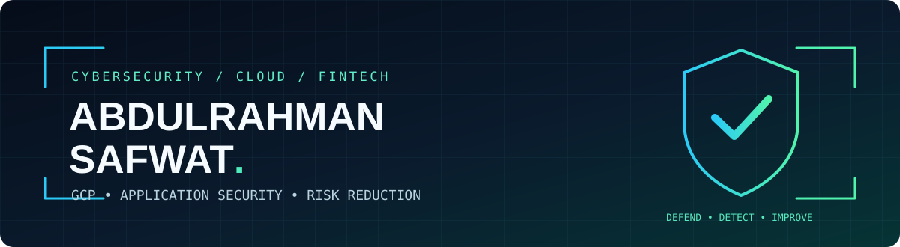

<p align="center"></p>

<div align="center">

### Cybersecurity Specialist • GCP Security • Web & API Security

**Protecting applications, APIs and cloud infrastructure through practical security engineering.**


[](mailto:abdelrahmansafwat684@gmail.com)
[](https://github.com/abdelrahmansafwat684-sys?tab=repositories)

</div>

---

### `> whoami`

Hi, I'm **Abdulrahman Safwat**, a cybersecurity professional focused on **web and API security, Google Cloud Platform (GCP), vulnerability management and FinTech security controls**.

My approach combines technical assessment, risk-based remediation, operational change control and clear communication with engineering teams.

### 🛡️ Areas of Focus

| Domain | What I focus on |
| --- | --- |
| 🌐 **Web & API Security** | OWASP risks, authentication, authorization, session security, secure integrations |
| ☁️ **Cloud Security (GCP)** | IAM, firewall exposure, load balancers, IAP, VMs, Cloud SQL, audit logging |
| 🔍 **Vulnerability Management** | Asset exposure, prioritization, remediation tracking and revalidation |
| 🔐 **Infrastructure Security** | TLS certificates, HTTPS, security headers and configuration hardening |
| 📋 **Security & Compliance** | PCI DSS control reviews, documentation, evidence and risk management |
| 🚨 **Security Operations** | Monitoring, secure change management, impact analysis and rollback planning |

### ⚙️ Technologies & Toolkit


### 🚀 Working Python Security Toolkit

**[Security Review Toolkit v1.0](https://github.com/abdelrahmansafwat684-sys/abdulrahman-safwat/tree/main/security-toolkit)** — three lightweight, read-only tools for authorized reviews: HTTP security headers, verified TLS certificate expiry, and offline Google Cloud IAM policy risk signals. Includes **10 offline unit tests** and GitHub Actions CI configuration for Python 3.11–3.13.

```bash
cd security-toolkit
python -m unittest discover -s tests -v
python security_toolkit.py iam examples/sample_iam_policy.json --json
```

Checks are limited in scope and must not be interpreted as penetration-test findings or compliance certification.

### 📂 Featured Public Security Resources

These resources are **generic, educational templates** — not confidential customer reports or claims of production testing.

- 🛡️ [Web & API Security — Review Checklist](https://github.com/abdelrahmansafwat684-sys/abdulrahman-safwat/blob/main/security-guides/web-api-security-checklist.md): authorization, session security, API reviews and finding documentation.
- ☁️ [Google Cloud — Security Baseline](https://github.com/abdelrahmansafwat684-sys/abdulrahman-safwat/blob/main/security-guides/gcp-security-baseline.md): IAM, network exposure, Cloud SQL, logging and safe change procedures.
- 🔐 [TLS & HTTP Security Headers — Notes](https://github.com/abdelrahmansafwat684-sys/abdulrahman-safwat/blob/main/security-guides/tls-http-security-checks.md): safe, authorized verification examples and a retest checklist.
- 📁 [Cybersecurity Notes & Portfolio](https://github.com/abdelrahmansafwat684-sys/abdulrahman-safwat): technical topics, public reference materials and future open projects.

### 📈 GitHub Activity

<p align="center">
  
  
</p>

### 🤝 Let's Connect

Open to **cybersecurity collaboration, security engineering opportunities and authorized assessment projects**.

📧 **Email:** [abdelrahmansafwat684@gmail.com](mailto:abdelrahmansafwat684@gmail.com)

<sub>**Security & confidentiality:** Public resources contain generalized guidance only. No credentials, customer data, private configurations, or unpublished assessment evidence are shared. All security testing requires explicit authorization.</sub>
